# F-Term

A terminal client for **F-Chat** (the F-List chat), written in Rust.

It runs as a full-screen terminal app (TUI) and covers the features of the official
F-Chat client: channels and private rooms, private messages, ads, dice, statuses,
profiles, friends and bookmarks, chat logs, character search, reports and all
channel and global moderator commands.

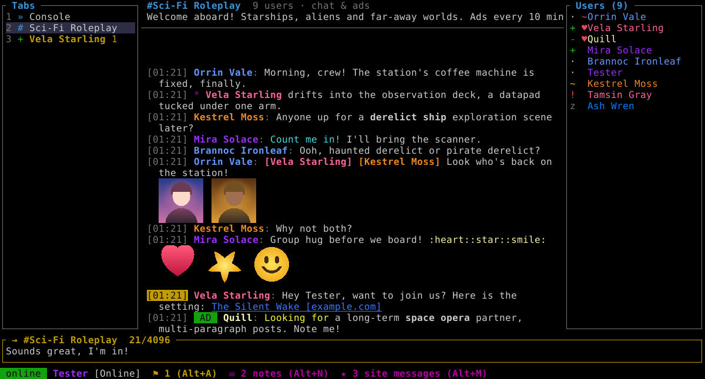

<details>
<summary>More screenshots</summary>

Images (avatars, eicons, profile pictures) are shown as real pixels in the GUI
versions and as coloured block characters in a terminal (`/images blocks`;
`/images native` uses the kitty, iTerm2 or sixel graphics of terminals that
have them).

| | |
|---|---|
| 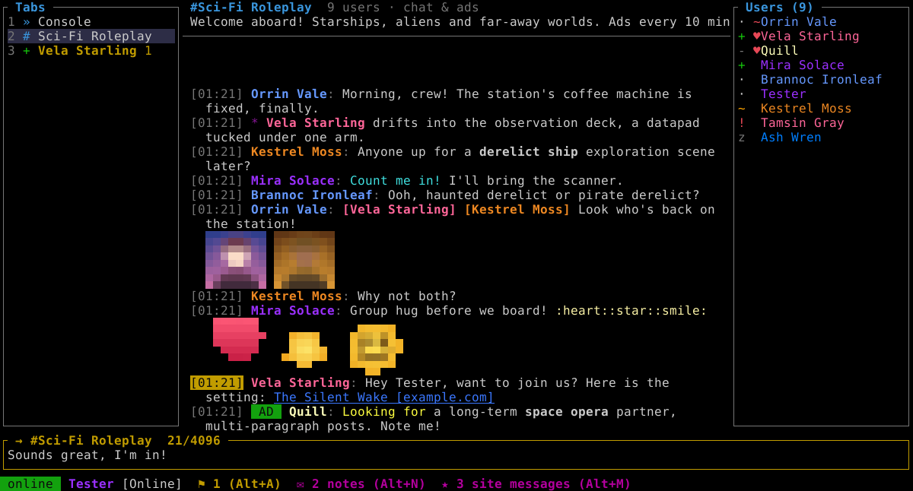 | 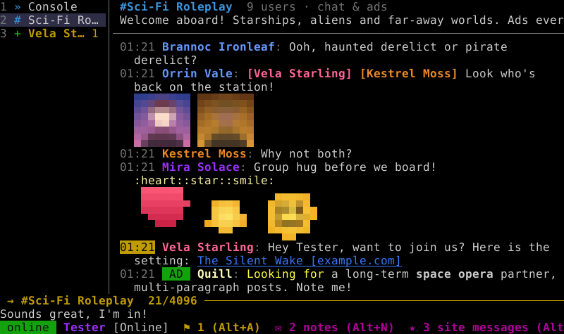 |
| The same chat in a terminal (block images, `/set inline_images on`) | Compact layout for screens up to 80 columns (here the 80x25 Windows 9x console) |
| 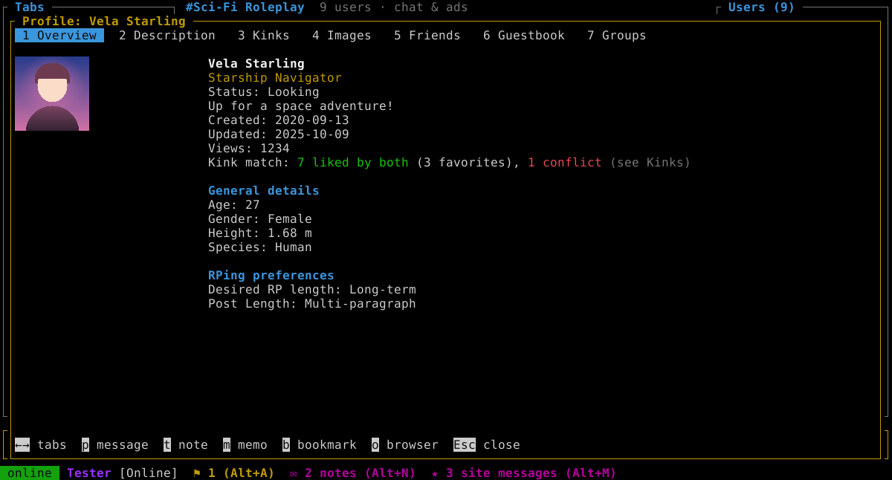 | 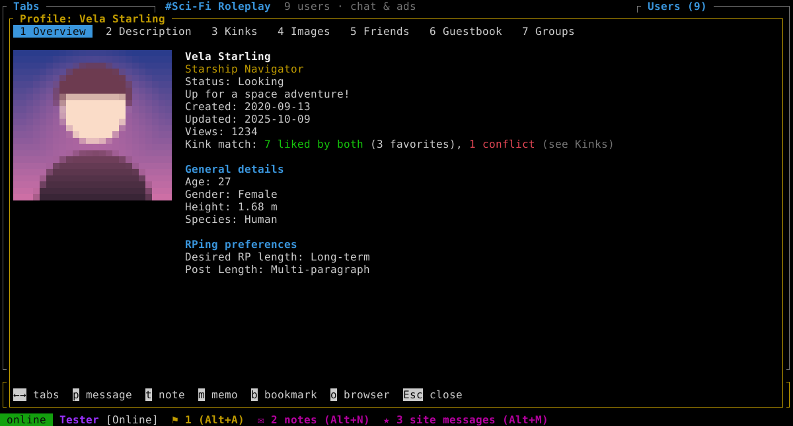 |
| Profile with the kink match (GUI) | The same in a terminal |
| 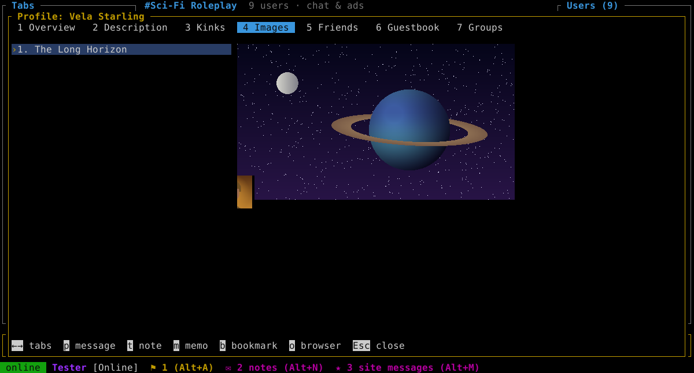 | 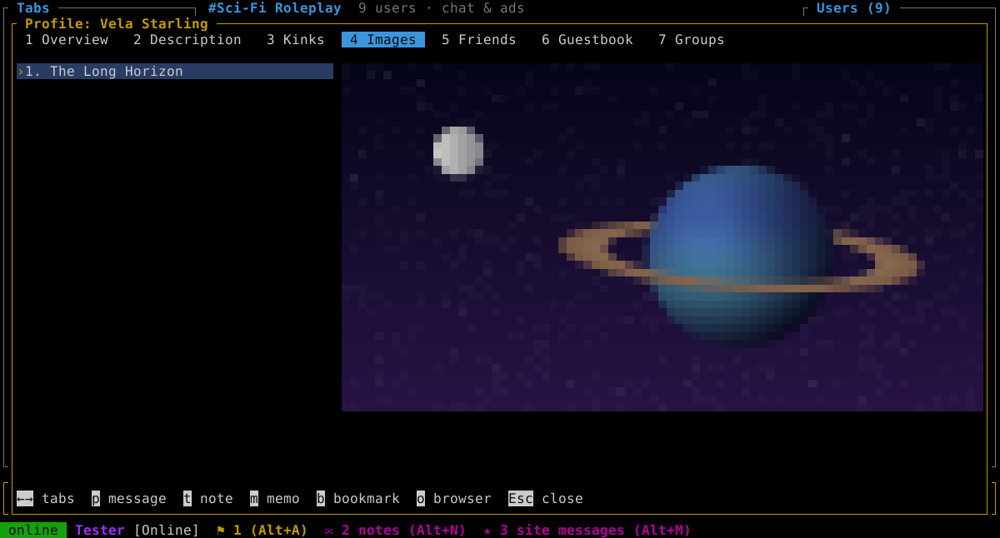 |
| Profile images (GUI, original size) | Profile images in a terminal |
| 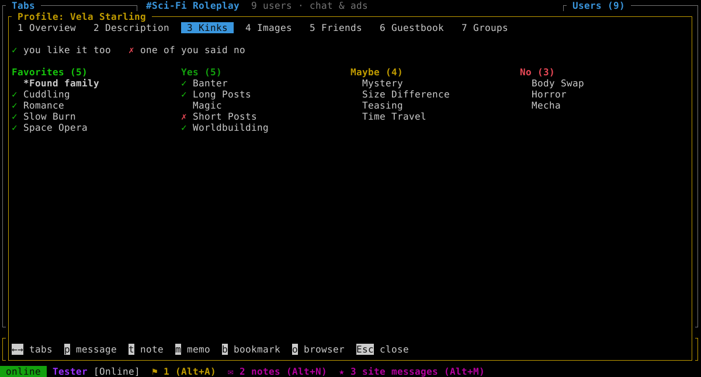 | 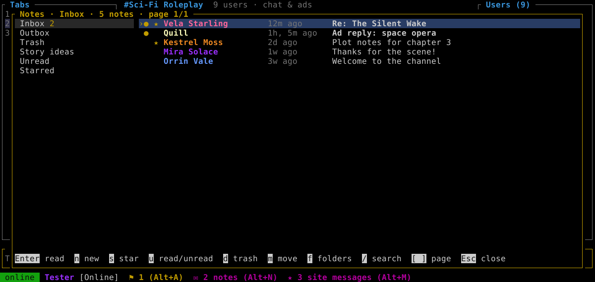 |
| Kinks tab: ✓ liked by both, ✗ conflicts | F-List notes (Alt+N) |
| 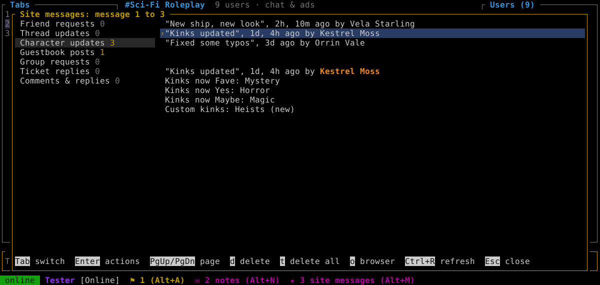 | 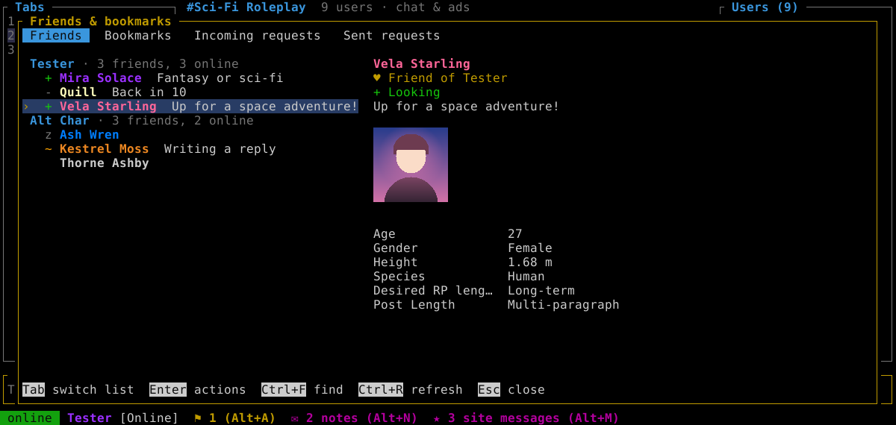 |
| Site messages with character updates (Alt+M) | Friends per character, with details (F3) |
| 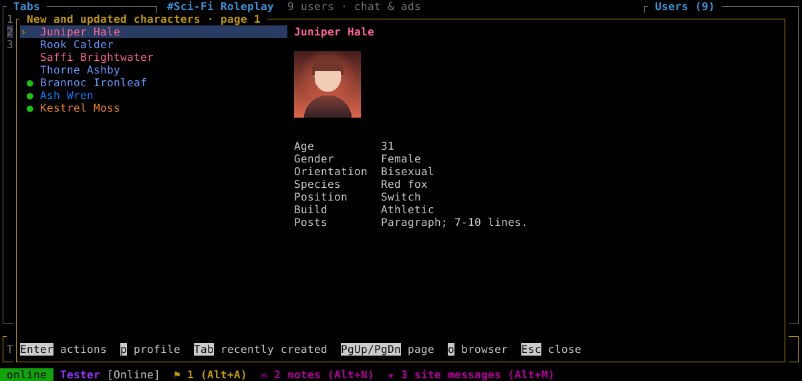 | 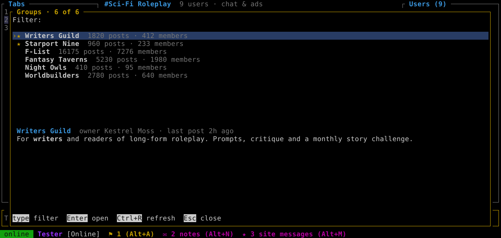 |
| New and updated characters (Alt+U) | F-List groups (Alt+G) |
| 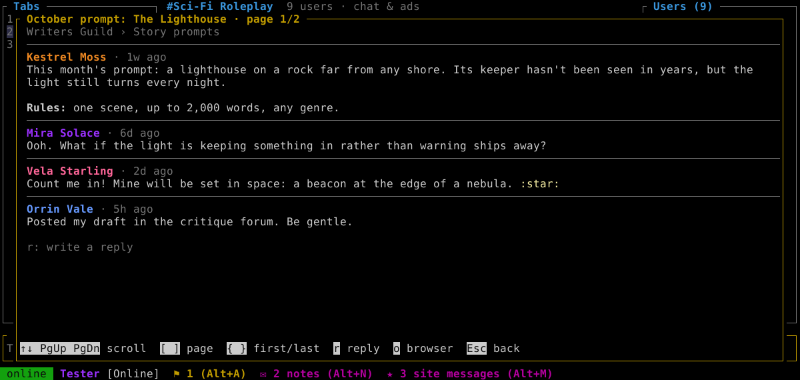 | 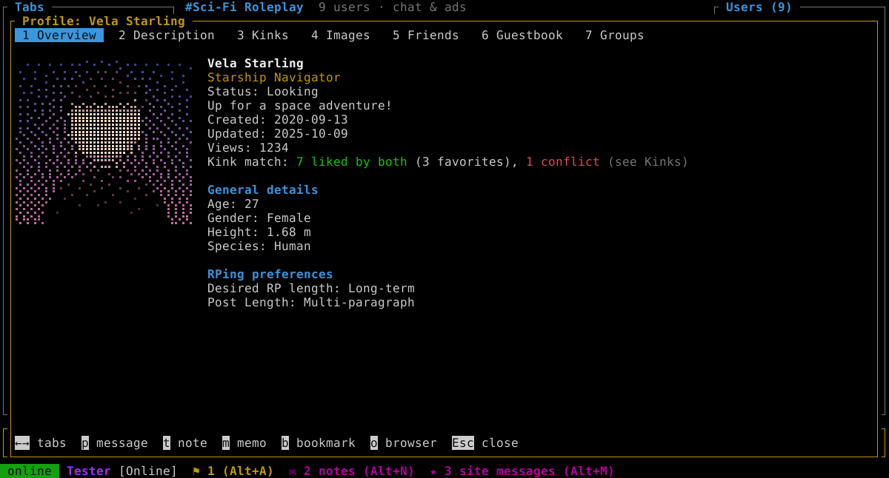 |
| Reading a group thread | A profile with Braille images (`/images braille`) |
| 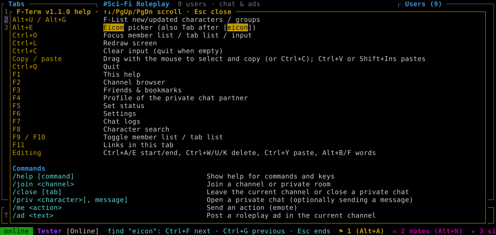 | 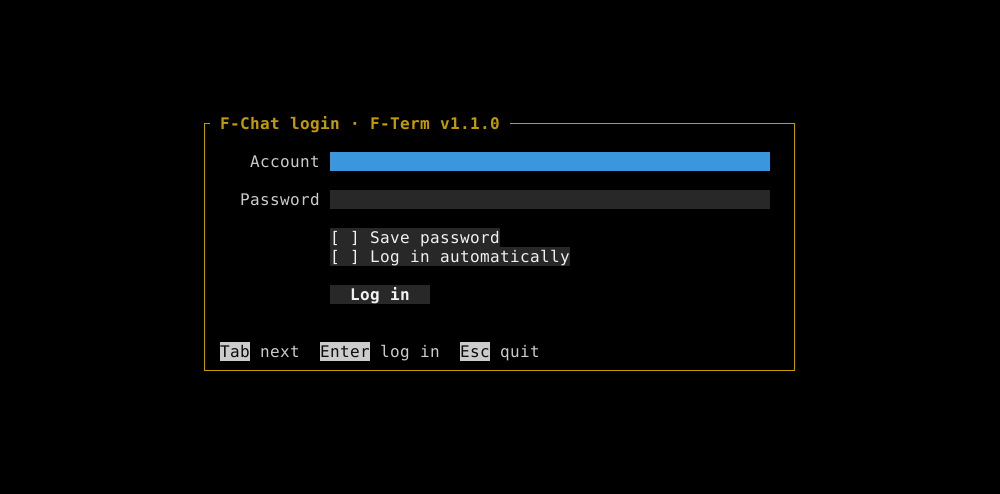 |
| Ctrl+F in any window, here the help | Login |

The screenshots show made-up characters and pictures. They are drawn by the
GUI version's renderer (the terminal ones with the terminal look) and can be
made again with `cargo test --features gui -- --ignored screenshots`.

</details>

## Features

- **Login**
  - Log in with your F-List account and pick a character.
  - Saved logins: account, optional saved password and optional auto-login.
  - Several accounts can be saved; switch with ↑/↓ on the account field.
- **Saved state**
  - Settings live in `settings.toml`. Change them in the app with **F6** or `/set`.
  - Per character, the app remembers open channels, private chats, recent status
    messages, muted tabs, ad visibility and saved ads. It rejoins and reopens them
    on the next login.
- **Channels**
  - Browse public channels and private rooms (**F2**), with filtering and sorting.
  - Join, leave, create private rooms (`/makeroom`) and invite people.
  - Each channel shows its description, member list (owner `~`, operators `@`,
    chat operators `&`, friends `♥`, bookmarks `★`) and mode (chat/ads/both).
- **Messages**
  - Private messages with typing notifications, `/me` actions, roleplay ads
    (`/ad`, saved ads via `/savead` and `/ads`), dice (`/roll`, `/bottle`) and
    `/warn`.
  - BBCode is rendered: bold, italic, underline, strikethrough, colours, URLs,
    `[user]`, `[icon]`, `[eicon]`, `[session]`, `[channel]`, spoilers, quotes,
    `[noparse]`, `[hr]` and more.
  - A "new messages" line marks where you stopped reading in a tab.
  - Search the current tab with **Ctrl+F** (`/find`): Ctrl+F jumps to older
    matches, Ctrl+G to newer ones, Esc ends the search.
  - Ad cooldown: the input box shows when the next ad may be posted in a
    channel (the server allows one every 10 minutes), and too early ads are
    held back instead of being rejected by the server.
- **Autocompletion** (Tab)
  - Command names, with usage, pop up as you type `/`.
  - Arguments complete too: characters, channel members, channels/rooms,
    statuses, channel modes, settings and log names.
  - Character names complete in normal text.
  - Eicon names complete after `[eicon]`.
- **Eicon picker** (**Alt+E**, `/eicons [search]`): search all eicons by name,
  with a preview, and insert one. F-List has no eicon search, so the list of
  names comes from the eicon database at [xariah.net](https://xariah.net/eicons/)
  (also used by the Horizon client). It is downloaded once (about 18 MB) on
  first use, kept in the cache folder and updated daily.
- **Images**, switchable at any time (`/images <mode>` or F6):
  - `off`
  - `ascii`: plain ASCII art, works on any terminal.
  - `colorascii`: coloured ASCII art.
  - `blocks`: coloured Unicode half-blocks. This is the default.
  - `braille`: coloured Unicode Braille dots, 2x4 dots per character, for
    finer detail (needs a font with Braille characters).

  The GUI versions have their own setting, `gui_image_mode`: `native`
  (the default) shows real pixels, the other modes look as in a terminal.
  - `native`: real pixels via the **kitty**, **iTerm2** or **sixel** graphics
    protocol, detected automatically or forced with `graphics_protocol`.

  Images appear in the profile viewer (avatar and gallery) and the image viewer
  (`/avatar`, `/eicon`, `/image <url>`, `/links`). With `inline_images` on, they
  also appear as small pictures under chat messages that contain
  `[icon]`/`[eicon]`.

  Animated GIFs and eicons play (`animate_images`, on by default), except with
  native terminal graphics, where they show their first frame.
- **Profiles** (**F4**, `/profile`): overview with info fields, description,
  kinks (including custom kinks and sub-kinks), images, friends, guestbook,
  groups and your private memo (`/memo`).
  - Kink match: the overview counts the kinks you both like and the conflicts
    (one of you likes it, the other said no). The kinks tab marks them with
    ✓ and ✗.
  - Sign the guestbook (**w** on the guestbook tab), publicly or privately.
- **F-List website features.** These are not in F-List's official API, so
  F-Term logs in to the website like a browser does, with the same account.
  The session is kept in memory only.
  - **Notes** (**Alt+N**, `/notes`): inbox, outbox, trash, your own folders,
    unread and starred notes. Read, reply, write (`/note <character>`), star,
    mark read or unread, move, trash and restore, report a note, and search
    by text or by character (`@name`). Folders can be created, renamed and
    deleted, and the trash can be emptied.
  - **Site messages** (**Alt+M**, `/messages`): the message center with
    friend requests, guestbook posts, comments, group requests, ticket
    replies, character and thread updates. Character updates list what
    changed (kinks, description, info fields, avatar); PgUp/PgDn pages
    through 20 messages at a time.
  - **Unread counters**: the status bar shows unread notes and site messages.
    They are checked every 5 minutes (`site_poll_minutes`, 0 = off) and right
    after the chat server announces a new note or other site event.
  - **News** (`/news [page]`): F-List's news posts.
  - **Roleplay ads** (`/personals [filter]`): the ads from the F-List front
    page, filterable by any text, with the full ad below the list.
  - **Browse New** (**Alt+U**, `/browse`): the website's new and updated
    characters, or with Tab (`/browse new`) the recently created ones, with
    their details and avatar. PgUp/PgDn pages through 20 at a time.
  - **Groups** (**Alt+G**, `/groups [name]`): all F-List groups (yours
    first), filterable by any text. Open a group to see its forums, a forum
    to see its threads, and a thread to read its posts page by page. Reply
    to a thread (**r**), start a new one (**n**), and join or leave a group
    with any of your characters (**J** / **L**).
- **Friends and bookmarks** (**F3**): lists with online status, accept, deny or
  cancel friend requests, bookmark, unbookmark, unfriend. Friends are listed
  in a section for each of your characters. Select an entry (also your own
  characters) to see their details at the right: status, avatar and profile
  fields. The console tab shows
  who of them is online, with their status, at the top right
  (`show_online_friends`, on by default). With `notify_online` set to
  `friends`, `bookmarks` or `both` (off by default), a box at the top right
  shows when one of them comes online or goes offline, on every tab (except the
  console while it shows the online list anyway).
- **Character search** (**F8**, `/search`) by kinks, genders, orientations,
  languages, furry preferences and roles.
- **Chat logs** are written to disk per conversation and day. Browse and search
  them with **F7**. Search all logs at once with `/logsearch <text>` (or
  Ctrl+F in the log browser). When you open a channel or private chat, its last
  lines from the log are shown (`load_history_lines`, 30 by default, 0 = off),
  and `/recent` lists recent conversations.
- **Notifications** for private messages and highlights (your name plus custom
  words):
  - terminal bell (in the GUI versions: the system sound on Windows, the
    desktop's message sound on Linux)
  - desktop notifications via OSC 9/777
  - a sound file of your own (`notify_sound`, a WAV file)
  - or your own command, e.g. `notify-send "%t" "%m"`

  Tabs can be muted individually. `/testnotify` tries your settings.
- **Status**
  - Online, looking, busy, DND, away and idle, with status messages (**F5**) and
    a list of recent ones.
  - Automatic idle status after N minutes.
- **Reports** (`/report`) upload a log of the current tab and alert the
  moderators.
- **Connection** reconnects automatically, respects the server's fatal error
  codes and flood limits, and answers pings.
- **Mouse support** (off by default; `/set mouse on` or **F6**): click tabs,
  users, online friends, list entries, login fields and any key hint (like the
  F-keys in the status bar or the keys under dialogs); scroll messages and lists
  with the wheel, or switch tabs by scrolling over the tab list.
- **Version**: shown on the login screen, in the console tab, in the help
  (F1) and the window title, and with `/version`.
- **Copy and paste**: in a terminal, use the terminal's own copy and paste
  (with mouse support on, hold Shift to select). Pasted text goes into the
  input line or the open dialog. The GUI versions select with the mouse and copy
  to the clipboard themselves (see [GUI versions](#gui-versions)).

## Installation

Download F-Term from the [releases page](https://github.com/TomTheDragon/f-term/releases).
Most downloads are a single program file with nothing to install. For Linux
there are also packages and an AppImage:

| Linux | Download | Install |
| --- | --- | --- |
| Ubuntu, Debian | `f-term_<version>-1_amd64.deb` | `sudo apt install ./f-term_<version>-1_amd64.deb` |
| Fedora | `f-term-<version>-1.x86_64.rpm` | `sudo dnf install ./f-term-<version>-1.x86_64.rpm` |
| any distribution | `F-Term-<version>-x86_64.AppImage` | `chmod +x F-Term-*.AppImage`, then run it |

The packages and the AppImage contain one program for both uses: run `f-term`
in a terminal to use it there, or start **F-Term** from the application menu
(or double-click the AppImage) for a window. The `.deb` and `.rpm` use the
system's DejaVu Sans Mono font and CA certificates (installed as
dependencies) instead of built-in copies, so they are smaller.

## Usage

```
f-term [--account NAME] [--character NAME] [--no-autologin] [--config-dir DIR] [--debug]
f-term --paths            # show where settings and logs are stored
f-term --forget NAME      # remove a saved login
f-term --window           # GUI builds: open a window
f-term --terminal         # Linux/macOS GUI builds: run in the terminal
```

Press **F1** in the app for all keys and commands (F1 help and F6 settings
open on top of any window). The most important ones:

| Key | Action |
| --- | --- |
| Enter / Alt+Enter | Send / new line |
| Tab, Shift+Tab | Autocomplete |
| Ctrl+N / Ctrl+P, Alt+1…9 | Switch tabs |
| Alt+A | Jump to the next unread tab |
| Alt+W | Close tab |
| Alt+J / Alt+P | Join a channel / open a private chat by name |
| Ctrl+F | Search the current tab |
| Alt+N / Alt+M | F-List notes / site messages |
| Alt+U / Alt+G | F-List new/updated characters / groups |
| Alt+E | Eicon picker |
| Ctrl+O | Move focus to the member list (Enter opens the user menu) and the tab list |
| PgUp / PgDn | Scroll |
| F2 … F8 | Channels, friends, profile, status, settings, logs, search |
| Ctrl+F in a window | Find text in any list or view: Ctrl+F next, Ctrl+G previous, Esc ends |
| Ctrl+Q | Quit |

Commands with several arguments use commas, e.g. `/timeout Some Name, 30`.

### Where data is stored

| | Linux | macOS | Windows |
| --- | --- | --- | --- |
| Settings and logins | `~/.config/f-term` | `~/Library/Application Support/f-term` | `%APPDATA%\f-term` |
| Logs | `~/.local/share/f-term/logs` | `…/f-term/data/logs` | `%APPDATA%\f-term\data\logs` |
| Image cache | `~/.cache/f-term` | `~/Library/Caches/f-term` | `%LOCALAPPDATA%\f-term\cache` |

For **portable mode**, put an empty file named `portable` next to the executable.
Everything is then stored in `f-term-data` beside it. Setting `F_TERM_HOME`
or using `--config-dir` does the same.

Folders from older versions (named `f-terminal`) are moved to the new names on
first start.

Saved passwords are only *obfuscated* in `accounts.toml` (the file is created
with owner-only permissions on Unix). Don't save the password on shared machines.

## Building

Normal build for your own machine:

```
cargo build --release
```

### GUI versions

The `*-gui` builds (cargo feature `gui`) draw the same screen in an own window
instead of a terminal (`src/ui/gui/`). The window can be any size, colours
aren't limited, and box-drawing, block and Braille characters are drawn as
shapes, so they line up with any font. Images (avatars, eicons, profile
pictures) are shown as real pixels (`gui_image_mode` = `native`, the default;
the other modes draw them with characters as in a terminal), and icons/eicons
under messages are on by default (`gui_inline_images`).

- Windows (95 to 11) draws with GDI and the system fonts (`gui/win32.rs`).
- Linux (X11 and Wayland) and macOS use [winit] with a software renderer and an
  embedded font, DejaVu Sans Mono (`gui/winit.rs`, `gui/soft.rs`,
  `assets/fonts`). On Linux without a display (e.g. over SSH) the GUI build
  runs in the terminal instead, and `--terminal` does so anyway.

Usage:

- Resize the window for more columns and rows; the size is remembered
  (`gui_columns`, `gui_rows`). `gui_font_size` sets the font height in pixels,
  and on Windows `gui_font` the font (empty = Lucida Console, or Courier New).
  Font changes apply after a restart.
- Copy: drag with the left mouse button to select text; letting go copies it
  (Ctrl+C or Ctrl+Insert also copy while something is selected; Cmd+C on
  macOS). Ctrl+V or Shift+Insert pastes. Closing the window works like Ctrl+Q.
- On macOS, Cmd works as Alt for shortcuts (Cmd+V pastes, Cmd+Q quits), and
  Option types characters as usual.
- On Windows, options that print something (`--help`, `--diagnose`, …) open a
  console window for their output, and errors are shown in a message box.
- For testing on Windows, `F_TERM_GUI_DUMP=<file.bmp>` saves every painted frame.

[winit]: https://github.com/rust-windowing/winit

### Cross-compiling all platforms

```
scripts/setup-tools.sh   # once: zig, cargo-zigbuild and llvm-mingw into ./.tools, rustup targets, Rust 1.77.2
scripts/build-all.sh     # all targets -> ./dist
scripts/build-all.sh linux-i586 windows-i686   # selected targets
```

| Output | Target | Runs on |
| --- | --- | --- |
| `f-term-linux-x86_64` | x86_64-unknown-linux-musl | any 64-bit Linux, static |
| `f-term-linux-i586` | i586-unknown-linux-musl | 32-bit Linux on Pentium-class CPUs and newer (no SSE/MMX), static |
| `f-term-macos-arm64` | aarch64-apple-darwin | Apple Silicon, macOS 11+ |
| `f-term-macos-x86_64` | x86_64-apple-darwin | Intel Macs, macOS 10.12+, `target-cpu=core2` (oldest x86-64 Mac CPU) |
| `f-term-windows-x86_64.exe` | x86_64-pc-windows-gnu (Rust 1.77.2, llvm-mingw) | Windows 7+ 64-bit |
| `f-term-windows-i686.exe` | i686-pc-windows-gnu (Rust 1.77.2, llvm-mingw) | Windows 7+ 32-bit |
| `f-term-windows-9x.exe` | i586-rust9x-windows-msvc ([rust9x]) | Windows 95/98/ME, NT4, 2000, XP |
| `f-term-*-gui[.exe]` | the same targets with feature `gui` | the same systems, in an own window instead of the terminal ([GUI versions](#gui-versions)) |

The Linux GUI builds use `x86_64`/`i586-unknown-linux-gnu.2.17` instead of musl:
they need glibc 2.17 or newer and load the X11 or Wayland libraries at run time.

The plain Linux builds are kept small: they use the system's CA certificates
(`system-certs`) and the GUI builds the system's DejaVu Sans Mono, or another
monospace font through fontconfig (`system-fonts`), instead of built-in
copies. They also abort on panics and are optimized for size. The packages
and the AppImage are built separately (see [Linux packages](#linux-packages)).
The macOS GUI builds need Apple's macOS SDK for AppKit: set `SDKROOT` to a
`MacOSX.sdk` folder, or build on a Mac; without it `build-all.sh` skips them.

Notes:

- **Rust 1.77.2** is the last Rust release that supports Windows 7, so the Windows
  builds use it. `rust-version = "1.77"` in `Cargo.toml` plus the MSRV-aware
  resolver keep all dependencies compatible.
- **The Windows builds link with [llvm-mingw]** (msvcrt variant), so they only
  need `msvcrt.dll`, which every Windows version has. No Visual C++ or Universal
  C Runtime install is needed on Windows 7.
  - Rust's windows-gnu targets expect GCC's `libgcc`/`libgcc_eh`, so
    `setup-tools.sh` provides llvm-mingw's compiler-rt and libunwind under those
    names.
  - It also adds a small shim (`scripts/mingw/frame-info-shim.c`) for the
    32-bit build.
  - Without llvm-mingw, `build-all.sh` falls back to zig. Those exes need the
    Universal C Runtime (KB2999226) on Windows 7.
- **i586 and Windows 9x** builds use the pure-Rust TLS backend
  (`--no-default-features --features tls-rustcrypto,images`), because `ring`
  requires SSE2.
- **getrandom** is vendored with a small patch (`vendor/getrandom-0.2.17`). It
  looks up the Windows RNG functions at runtime, because the upstream crate
  imports `bcrypt.dll` and would not start on Windows 9x/XP.

### Linux packages

```
scripts/setup-tools.sh      # once; also installs cargo-deb, cargo-generate-rpm and appimagetool
scripts/package-linux.sh    # -> dist/*.deb, dist/*.rpm, dist/*.AppImage (x86-64)
```

All three contain one binary built with `gui` and `prefer-terminal`: it runs
in the terminal when started from one, and opens a window when started from
the desktop or with `--window`. The binaries are built for
`x86_64-unknown-linux-gnu.2.17` (glibc 2.17 or newer, X11/Wayland loaded at
run time).

- The `.deb` and `.rpm` also use `system-fonts` and `system-certs`: the window
  uses the system's DejaVu Sans Mono and TLS trusts the system's CA bundle
  (`/etc/ssl/certs/ca-certificates.crt`, `/etc/pki/ca-trust/...`, or
  `SSL_CERT_FILE`), instead of built-in copies. The packages depend on
  `fonts-dejavu-core`/`dejavu-sans-mono-fonts` and `ca-certificates`, and
  recommend the X11/Wayland libraries (only needed for the window).
  Package details are in `[package.metadata.deb]` and
  `[package.metadata.generate-rpm]` in `Cargo.toml`.
- The AppImage keeps the built-in font and certificates, so it runs anywhere.
- Desktop file, AppStream metadata and icon: `packaging/linux/` and
  `assets/f-term.svg`. The app ID is `io.github.tomthedragon.f-term`; the
  window uses it too, so the desktop shows the right name and icon.

### Windows 9x (rust9x)

The Windows 9x build uses the [rust9x] toolchain (`rustup toolchain link rust9x …`)
and the target `i586-rust9x-windows-msvc`. It normally links without any Microsoft
libraries: `scripts/r9x/build-libs.sh` (run by `build-all.sh`) builds free
replacements into `.tools/r9x-libs`:

- `libcmt.lib`: a minimal C runtime (`scripts/r9x/crt.c`). It imports only basic
  string and math functions from `msvcrt.dll` (`scripts/r9x/msvcrt.def`).
- `unicows.lib`: loads the Unicode (W) functions listed in
  `scripts/r9x/unicows.txt` at first use, from `unicows.dll` on Windows 9x/ME and
  from the system DLLs on NT-based Windows. `build-all.sh` warns if the exe
  imports a W function that is not listed.
  On Windows 9x/ME, console input and output use its own wrappers around the
  native ANSI console functions, converting with the console code page. For
  testing, `F_TERM_R9X_CONSOLE=1` uses these wrappers on NT-based Windows too,
  and `F_TERM_CONLOG=<file>` logs every console input record.
- System import libraries, taken from llvm-mingw.

The build uses `panic = "abort"`. The free runtime has no C++ exception
support, so panics can't unwind.

To link with Microsoft's own libraries instead (Visual C++ 2005 `VC/lib` and
`VC/PlatformSDK/Lib`, Platform SDK 5.2.3790 `Lib` for `unicows.lib`), point
`R9X_LIBPATHS` at them:

```
R9X_LIBPATHS="/path/vc8/VC/lib;/path/vc8/VC/PlatformSDK/Lib;/path/psdk3790/Lib" \
    scripts/build-all.sh windows-9x
```

Put those on a case-insensitive filesystem (or an ext4 folder with `chattr +F`),
because crates refer to them with different casing.

On Windows 9x/ME the computer also needs:

- `msvcrt.dll`. Windows 98 and later have it; on Windows 95 it comes with Internet
  Explorer 4 or a Visual C++ 6 runtime installer.
- `unicows.dll` (Microsoft Layer for Unicode) next to the exe.
- WinSock 2. Windows 95 needs the WinSock 2 update.
- A TrueType console font, so box-drawing characters display. Use
  `/set ascii_borders on` and `/images ascii` if they still look wrong.

Only `ascii`/`blocks` image modes make sense in the 9x console.

On screens of 80 columns or less (like the 9x console), every version uses
a compact layout: a narrower tab list with a single separator line, and an
input box without side borders. For more room, use the GUI version.

The GUI version `f-term-windows-9x-gui.exe` needs the same files as the
console version (`unicows.dll` etc.).

[rust9x]: https://github.com/rust9x/rust
[llvm-mingw]: https://github.com/mstorsjo/llvm-mingw

## Development

```
cargo test     # unit tests + an end-to-end test against a local mock F-Chat server
cargo run -- --debug    # writes a protocol log to debug.log in the config dir
```

The Windows builds can be tested under [Wine]. Put a Wine build in `.tools/wine`
(for example a portable "amd64-wow64" build from [Kron4ek/Wine-Builds]) or set
`WINE=/path/to/wine`, then run:

```
scripts/test-windows.sh          # cargo test for x86_64 and i686 Windows under Wine
scripts/test-windows.sh x86_64   # one architecture only
```

[Wine]: https://www.winehq.org/
[Kron4ek/Wine-Builds]: https://github.com/Kron4ek/Wine-Builds

Protocol references:

- [F-Chat server commands](https://wiki.f-list.net/F-Chat_Server_Commands)
- [F-Chat client commands](https://wiki.f-list.net/F-Chat_Client_Commands)
- [F-Chat error codes](https://wiki.f-list.net/F-Chat_Error_Codes)
- [F-List JSON API](https://toys.in.newtsin.space/api-docs/)

The website features (notes, site messages, news, roleplay ads, Browse New,
groups, guestbook posts) use the website's own JSON endpoints and pages, as
a browser does (`src/site.rs`). To test them against the real site with a test account:

```
FLIST_TEST_ACCOUNT=… FLIST_TEST_PASSWORD=… cargo test -- --ignored site_live
```

## License

MIT, see [LICENSE](LICENSE). The vendored crates keep their own licenses:
`getrandom` MIT/Apache-2.0 (`vendor/getrandom-0.2.17`), `crossterm_winapi`
MIT (`vendor/crossterm_winapi-0.9.1`). The DejaVu Sans Mono font
embedded in the Linux/macOS GUI builds is under its own free license
(`assets/fonts/DejaVu-LICENSE.txt`).

This is an unofficial client and is not affiliated with F-List.
